# Trần Duy Trường — Portfolio

Personal portfolio of **Trần Duy Trường**, an AI/ML engineer in Hanoi: HCMUT Computer Science graduate, AI Engineer Intern at VinSmart Future, focused on grounded RAG systems, LLM evaluation and applied ML research.

**Live site:** https://portfolio-itme6.vercel.app

## What's on the site

- **Projects** — four pieces of work:
  - **GPTResident**, a grounded multi-tenant RAG assistant evaluated on a 201-case golden benchmark.
  - **FA-GPNet**, a co-authored MIWAI 2025 paper on motor-imagery EEG classification.
  - A LangGraph **multi-agent RAG** customer-support system.
  - A **Qwen3.5-4B** QLoRA fine-tuning notebook.
- **Architecture diagrams** — inline SVG drawn from each project's actual pipeline (no screenshots or mock dashboards).
- **Skills** — grouped by area; solid tags are used in projects/internships, dashed tags are practised in labs and coursework.
- **Experience & education** — VinSmart Future, the Vingroup AI Talent Program, HCMUT, Xuan Cuong Technology.
- **Terminal** — a small toy shell (`help`, `about`, `projects`, `skills`, `education`, `experience`, `github`, `contact`, `neofetch`, `arise`, `clear`).
- **Contact** — email, both GitHub accounts, and a form that opens a pre-filled `mailto:` draft (the site has no backend and stores nothing).

## Where the code lives

| Account | Contents |
|---|---|
| [`tranduytruong12`](https://github.com/tranduytruong12) | Personal projects and coursework |
| [`truong311203-arch`](https://github.com/truong311203-arch) | VinUniversity AI20K lab repos (forks of the program's starter kits), this site, profile README |

## Tech

Plain HTML, CSS and JavaScript — no build step, no framework, no runtime dependencies besides Google Fonts. Deployed on [Vercel](https://vercel.com) (`vercel.json` sets clean URLs, revalidated asset caching and basic security headers).

```
index.html
assets/
  css/style.css     design system + components
  js/main.js        nav, terminal, project filters, copy-email, mailto form, counters
  images/           portrait + favicon
```

## Run locally

```bash
python -m http.server 3000   # then open http://localhost:3000
# or
npx serve .
```

## Keeping it accurate

Every number on the site comes from the CV or from a project's own README/evaluation report. When the CV changes, update `index.html` (stats bar, GPTResident card, experience timeline) at the same time.

## Contact

- Email: [truong311203@gmail.com](mailto:truong311203@gmail.com)
- GitHub: [@tranduytruong12](https://github.com/tranduytruong12) · [@truong311203-arch](https://github.com/truong311203-arch)

<!-- AWAKEN:START -->
<!-- Generated by git-profile-awaken. Edit awaken.json instead of this block. -->
<p align="center">
<picture><source media="(prefers-color-scheme: dark)" srcset="awaken/hunter-dark.svg"><source media="(prefers-color-scheme: light)" srcset="awaken/hunter-light.svg"></picture>
</p>

<p align="center">
<picture><source media="(prefers-color-scheme: dark)" srcset="awaken/ladder-dark.svg"><source media="(prefers-color-scheme: light)" srcset="awaken/ladder-light.svg"></picture>
</p>

<p align="center">
<picture><source media="(prefers-color-scheme: dark)" srcset="awaken/web-dark.svg"><source media="(prefers-color-scheme: light)" srcset="awaken/web-light.svg"></picture>
<picture><source media="(prefers-color-scheme: dark)" srcset="awaken/skills-dark.svg"><source media="(prefers-color-scheme: light)" srcset="awaken/skills-light.svg"></picture>
</p>

<p align="center">
<picture><source media="(prefers-color-scheme: dark)" srcset="awaken/activity-dark.svg"><source media="(prefers-color-scheme: light)" srcset="awaken/activity-light.svg"></picture>
</p>

<p align="center">
<picture><source media="(prefers-color-scheme: dark)" srcset="awaken/quest-dark.svg"><source media="(prefers-color-scheme: light)" srcset="awaken/quest-light.svg"></picture>
<picture><source media="(prefers-color-scheme: dark)" srcset="awaken/contribution-dark.svg"><source media="(prefers-color-scheme: light)" srcset="awaken/contribution-light.svg"></picture>
</p>

<p align="center">
<picture><source media="(prefers-color-scheme: dark)" srcset="awaken/oracle-dark.svg"><source media="(prefers-color-scheme: light)" srcset="awaken/oracle-light.svg"></picture>
<picture><source media="(prefers-color-scheme: dark)" srcset="awaken/daily-dark.svg"><source media="(prefers-color-scheme: light)" srcset="awaken/daily-light.svg"></picture>
</p>

<p align="center">
<picture><source media="(prefers-color-scheme: dark)" srcset="awaken/rune-str-dark.svg"><source media="(prefers-color-scheme: light)" srcset="awaken/rune-str-light.svg"></picture>
<picture><source media="(prefers-color-scheme: dark)" srcset="awaken/rune-agi-dark.svg"><source media="(prefers-color-scheme: light)" srcset="awaken/rune-agi-light.svg"></picture>
<picture><source media="(prefers-color-scheme: dark)" srcset="awaken/rune-int-dark.svg"><source media="(prefers-color-scheme: light)" srcset="awaken/rune-int-light.svg"></picture>
<picture><source media="(prefers-color-scheme: dark)" srcset="awaken/rune-vit-dark.svg"><source media="(prefers-color-scheme: light)" srcset="awaken/rune-vit-light.svg"></picture>
</p>

<p align="center">
<picture><source media="(prefers-color-scheme: dark)" srcset="awaken/rune-luk-dark.svg"><source media="(prefers-color-scheme: light)" srcset="awaken/rune-luk-light.svg"></picture>
<picture><source media="(prefers-color-scheme: dark)" srcset="awaken/rune-cha-dark.svg"><source media="(prefers-color-scheme: light)" srcset="awaken/rune-cha-light.svg"></picture>
</p>
<!-- AWAKEN:END -->
